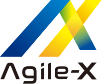
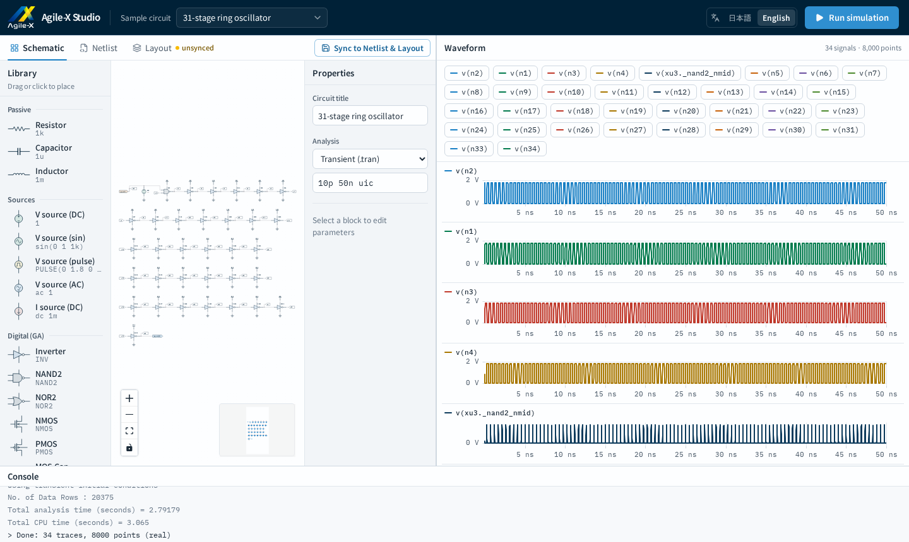
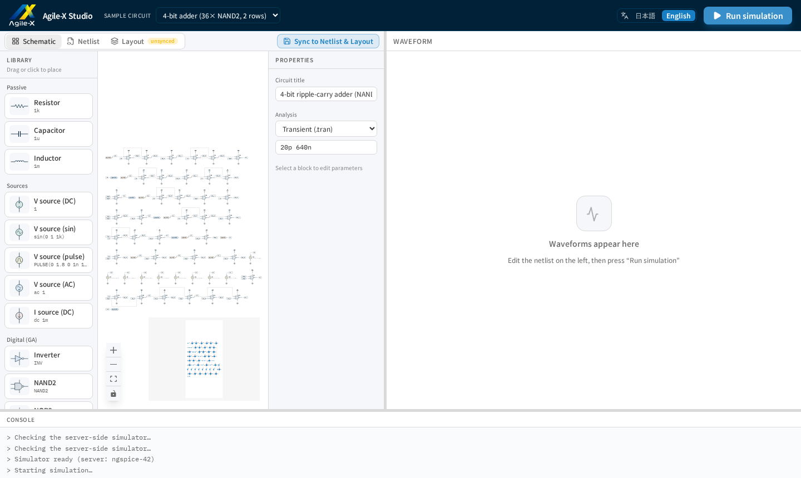
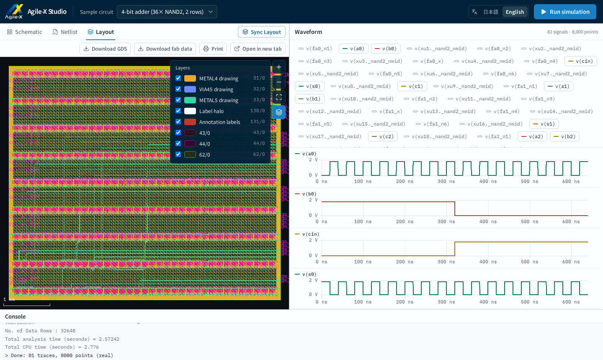

<p align="center">
  <picture>
    <source media="(prefers-color-scheme: dark)" srcset="public/agilex-logo-header.svg">
    
  </picture>
</p>

<h1 align="center">Agile-X Studio</h1>

<p align="center">
  <strong>A browser-based circuit design, simulation and layout environment for the <a href="https://www.agile-x.t.u-tokyo.ac.jp/en/">Agile-X</a> gate array.</strong><br>
  Draw a schematic, simulate it with ngspice on the server, and place and route it on the gate array automatically.
</p>

<p align="center">
  <a href="LICENSE"></a>
  
  
</p>

<p align="center">
  <a href="https://kadomoto-lab.github.io/agile-x-studio/en/">Documentation</a> ·
  <a href="#getting-started">Getting started</a> ·
  <a href="https://kadomoto-lab.github.io/agile-x-studio/en/getting-started/first-circuit/">Your first circuit</a> ·
  <a href="https://kadomoto-lab.github.io/agile-x-studio/en/tutorials/adder/">4-bit adder</a> ·
  <a href="README.md">日本語</a>
</p>

<p align="center">
  
</p>

Agile-X Studio is an app for designing and checking digital circuits for the Agile-X gate array in the browser.
Schematic, netlist, waveforms and layout share one screen, and a circuit you draw goes all the way to a GDS file for
fabrication.

## Features

- **Schematic and netlist**: an editor for placing and wiring parts, and an editor for the SPICE netlist. Edit either
  one and carry the change to the other.
- **Simulation on the server**: ngspice runs in batch mode on the API server and the browser draws the waveforms.
  `.meas` and `.control` work as they are.
- **Automatic placement and routing**: INV, NAND2 and NOR2 gates go onto 9 rows × 35 columns of base cells and are
  routed in METAL5. A circuit that does not fit in one row spans several, with routes between rows using the jumpers
  built into the base.
- **Verified output**: each result is checked for shorts, opens and spacing from the shapes that are written out, and
  only a result that passes is used.
- **GDS output**: download `combined.gds` (merged with the base) and `combined_forfab.gds` for fabrication.
- **Japanese and English**: switch the interface language at any time from the top right.

<table>
  <tr>
    <td width="50%"><br><sub><b>Schematic</b>: a 4-bit adder of 36 NAND2 gates</sub></td>
    <td width="50%"><br><sub><b>Layout</b>: placed across two rows and routed to the I/O pads</sub></td>
  </tr>
</table>

## Getting started

### Requirements

- Linux, macOS, or Windows with WSL2 (tested on Ubuntu / WSL2)
- Node.js 20 or later
- [uv](https://docs.astral.sh/uv/) (manages Python packages and environments; it also provides Python 3.12 or later)
- [ngspice](https://ngspice.sourceforge.io/)

Typical ways to install them on each OS (Node.js comes from [nvm](https://github.com/nvm-sh/nvm)):

<details>
<summary><b>Ubuntu / Debian family (including WSL2)</b></summary>

```bash
sudo apt update
sudo apt install -y git curl ngspice
curl -LsSf https://astral.sh/uv/install.sh | sh  # uv
curl -o- https://raw.githubusercontent.com/nvm-sh/nvm/v0.40.3/install.sh | bash  # nvm
source ~/.bashrc  # or open a new terminal
nvm install 22  # Node.js 22
```

Ubuntu's own `nodejs` package is too old (18 on 24.04), so Node.js comes from nvm. Even if the OS's Python is older
than 3.12, uv fetches and uses 3.12 or later.

</details>

<details>
<summary><b>macOS (Homebrew)</b></summary>

```bash
xcode-select --install  # git, if not installed yet
brew install node uv ngspice
```

</details>

<details>
<summary><b>Windows</b></summary>

Run it inside Ubuntu on WSL2. Open PowerShell as administrator and run the command below; after restarting, open
Ubuntu and follow the Ubuntu / Debian steps above.

```powershell
wsl --install -d Ubuntu-24.04
```

</details>

Check with `node --version` (v20 or later), `uv --version` and `ngspice --version`.

### Install and run

```bash
git clone https://github.com/kadomoto-lab/agile-x-studio.git
cd agile-x-studio
uv sync            # Python and the dependencies into .venv (the versions in uv.lock)
npm install
npm run dev:en     # the interface at http://localhost:5173 and the API server at 127.0.0.1:8000
```

Open <http://localhost:5173>. When the console says `Simulator ready`, press **Run simulation** at the top right to
see the waveforms of the sample 31-stage ring oscillator.

> [!NOTE]
> npm scripts call Python through `uv run`, so there is no venv to activate.

> [!IMPORTANT]
> The API server has no authentication and runs ngspice on the netlists it receives. Use it on your own machine or on
> a network you trust.

Continue with [Your first circuit](https://kadomoto-lab.github.io/agile-x-studio/en/getting-started/first-circuit/),
which takes an inverter chain through simulation and layout.

## Documentation

The documentation is at [kadomoto-lab.github.io/agile-x-studio/en](https://kadomoto-lab.github.io/agile-x-studio/en/)
(English) and [kadomoto-lab.github.io/agile-x-studio](https://kadomoto-lab.github.io/agile-x-studio/) (Japanese, the
source). Its source is in [`docs/`](docs/).

- **Start:** [Install](https://kadomoto-lab.github.io/agile-x-studio/en/getting-started/install/) ·
  [Your first circuit](https://kadomoto-lab.github.io/agile-x-studio/en/getting-started/first-circuit/) ·
  [Overview](https://kadomoto-lab.github.io/agile-x-studio/en/overview/)
- **Tutorial:** [A 4-bit adder across two rows](https://kadomoto-lab.github.io/agile-x-studio/en/tutorials/adder/)
- **User guide:** [Schematic editor](https://kadomoto-lab.github.io/agile-x-studio/en/guide/schematic/) ·
  [Netlist](https://kadomoto-lab.github.io/agile-x-studio/en/guide/netlist/) ·
  [Simulation](https://kadomoto-lab.github.io/agile-x-studio/en/guide/simulation/) ·
  [Layout](https://kadomoto-lab.github.io/agile-x-studio/en/guide/layout/) ·
  [Interface language](https://kadomoto-lab.github.io/agile-x-studio/en/guide/language/)
- **Reference:** [Gate array](https://kadomoto-lab.github.io/agile-x-studio/en/reference/gate-array/) ·
  [HTTP API](https://kadomoto-lab.github.io/agile-x-studio/en/reference/api/) ·
  [Commands and configuration](https://kadomoto-lab.github.io/agile-x-studio/en/reference/configuration/)
- **Help:** [Troubleshooting and FAQ](https://kadomoto-lab.github.io/agile-x-studio/en/troubleshooting/) ·
  [Issues](https://github.com/kadomoto-lab/agile-x-studio/issues)
- **Development:** [Architecture and development](https://kadomoto-lab.github.io/agile-x-studio/en/development/) ·
  [Licenses](https://kadomoto-lab.github.io/agile-x-studio/en/licenses/)

## Built with

| Area | Built with |
|---|---|
| Interface | React 19, Vite, TypeScript, Tailwind CSS |
| Schematic | [@xyflow/react](https://reactflow.dev/) |
| Netlist editor | Monaco Editor |
| Waveforms | [uPlot](https://github.com/leeoniya/uPlot) |
| Layout viewer | tiles drawn on the server with the [KLayout](https://www.klayout.de/) Python module, shown on a canvas |
| API server | FastAPI, uvicorn (Python environment managed with [uv](https://docs.astral.sh/uv/)) |
| Simulation | [ngspice](https://ngspice.sourceforge.io/) (batch mode) |
| GDS generation | [gdsfactory](https://github.com/gdsfactory/gdsfactory), the KLayout Python module |

## Development

```bash
npx tsc -b                       # type check
npm run lint                     # ESLint
npm run test:ga                  # placement and routing tests
npm run build:en                 # build with English as the default → dist-en/ (Japanese: npm run build → dist/)
```

The directory layout, the rules for interface strings (i18n) and how to build the documentation are in
[Architecture and development](https://kadomoto-lab.github.io/agile-x-studio/en/development/).

## License

[MIT License](LICENSE). The repository and the built interface contain no GPL code. The licenses of the software it
works with, such as the KLayout Python module (GPL-3.0-or-later) that the API server imports, and notes on
distribution are in [Licenses](https://kadomoto-lab.github.io/agile-x-studio/en/licenses/).
