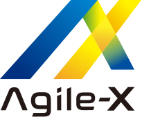
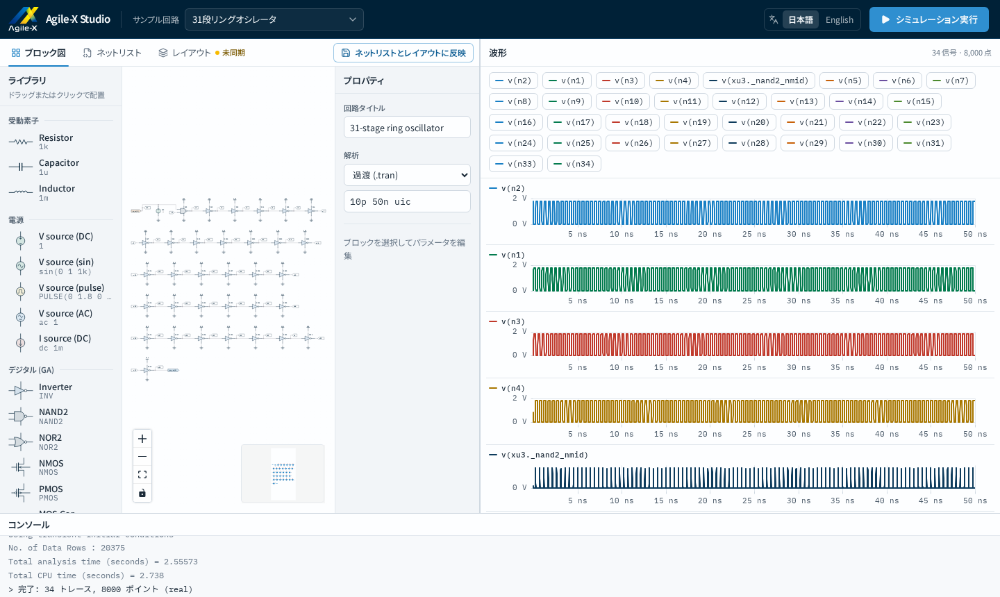
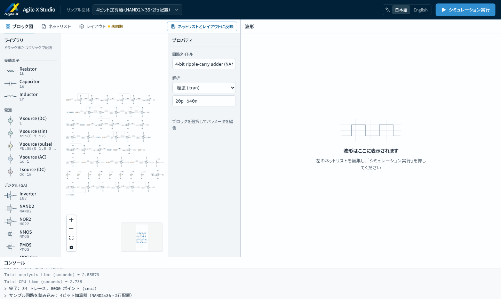
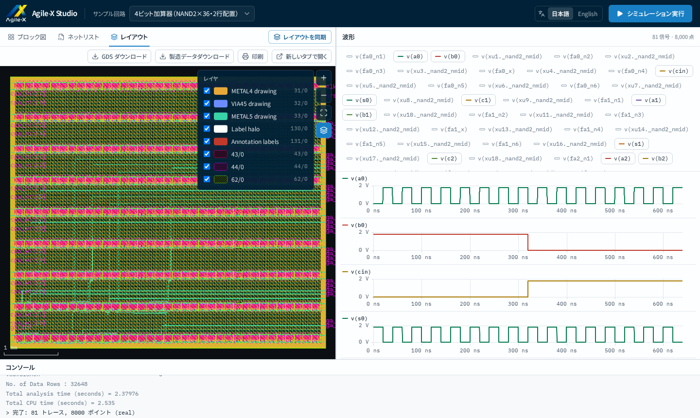

<p align="center">
  <picture>
    <source media="(prefers-color-scheme: dark)" srcset="public/agilex-logo-header.svg">
    
  </picture>
</p>

<h1 align="center">Agile-X Studio</h1>

<p align="center">
  <strong><a href="https://www.agile-x.t.u-tokyo.ac.jp/">Agile-X</a> ゲートアレイ向けの、ブラウザで使う回路設計・シミュレーション・レイアウト環境</strong><br>
  ブロック図で描いた回路を、サーバ側の ngspice でシミュレーションし、ゲートアレイに自動で配置・配線します。
</p>

<p align="center">
  <a href="LICENSE"></a>
  
  
</p>

<p align="center">
  <a href="https://kadomoto-lab.github.io/agile-x-studio/">ドキュメント</a> ·
  <a href="#はじめに">はじめに</a> ·
  <a href="https://kadomoto-lab.github.io/agile-x-studio/getting-started/first-circuit/">最初の回路</a> ·
  <a href="https://kadomoto-lab.github.io/agile-x-studio/tutorials/adder/">4 ビット加算器</a> ·
  <a href="README.en.md">English</a>
</p>

<p align="center">
  
</p>

Agile-X Studio は、Agile-X のゲートアレイで動くデジタル回路を、ブラウザの中で設計して確かめるためのアプリです。ブロック図・ネットリスト・波形・レイアウトが 1 つの画面に並び、描いた回路をそのまま製造用の GDS まで持っていけます。

## 特長

- **ブロック図とネットリスト**: 部品を並べて配線するエディタと、SPICE ネットリストのエディタ。どちらで編集しても、もう一方に反映できます。
- **サーバ側のシミュレーション**: ngspice を API サーバでバッチ実行し、波形をブラウザに表示します。`.meas` や `.control` もそのまま使えます。
- **ゲートアレイへの自動配置・配線**: INV・NAND2・NOR2 を 9 行 × 35 列のベースセルに配置し、METAL5 で配線します。1 行に収まらない回路は複数の行に分け、行の間はベースに組み込まれたジャンパで配線します。
- **出力の検証**: 配線結果を、書き出す図形そのものからショート・オープン・間隔違反について確かめ、通ったものだけを使います。
- **GDS の書き出し**: ベースと重ねた `combined.gds` と、製造用の `combined_forfab.gds` をダウンロードできます。
- **日本語と英語**: 表示言語は画面右上でいつでも切り替えられます。

<table>
  <tr>
    <td width="50%"><br><sub><b>ブロック図</b>: NAND2 36 個の 4 ビット加算器</sub></td>
    <td width="50%"><br><sub><b>レイアウト</b>: 2 行にまたがる配置と、I/O パッドまでの配線</sub></td>
  </tr>
</table>

## はじめに

### 必要なもの

- Linux、macOS、または Windows の WSL2（動作確認は Ubuntu / WSL2）
- Node.js 20 以上
- [uv](https://docs.astral.sh/uv/)（Python のパッケージと環境の管理。Python 3.12 以上も uv が用意します）
- [ngspice](https://ngspice.sourceforge.io/)

OS ごとの典型的な入れ方です（Node.js は [nvm](https://github.com/nvm-sh/nvm) で入れます）。

<details>
<summary><b>Ubuntu / Debian 系（WSL2 を含む）</b></summary>

```bash
sudo apt update
sudo apt install -y git curl ngspice
curl -LsSf https://astral.sh/uv/install.sh | sh  # uv
curl -o- https://raw.githubusercontent.com/nvm-sh/nvm/v0.40.3/install.sh | bash  # nvm
source ~/.bashrc  # または新しいターミナルを開く
nvm install 22  # Node.js 22
```

Ubuntu の `nodejs` パッケージは古い（24.04 で 18）ため、Node.js は nvm で入れます。Python は OS のものが 3.12 より古くても、uv が 3.12 以上を取得して使います。

</details>

<details>
<summary><b>macOS（Homebrew）</b></summary>

```bash
xcode-select --install  # git（未導入の場合）
brew install node uv ngspice
```

</details>

<details>
<summary><b>Windows</b></summary>

WSL2 の Ubuntu の中で動かします。PowerShell を管理者として開いて実行し、再起動後に Ubuntu を開いて、上の「Ubuntu / Debian 系」の手順に進んでください。

```powershell
wsl --install -d Ubuntu-24.04
```

</details>

入ったかどうかは `node --version`（v20 以上）、`uv --version`、`ngspice --version` で確かめられます。

### インストールと起動

```bash
git clone https://github.com/kadomoto-lab/agile-x-studio.git
cd agile-x-studio
uv sync            # Python と依存パッケージを .venv に入れる（uv.lock どおりの版）
npm install
npm run dev        # 画面 http://localhost:5173 と API サーバ 127.0.0.1:8000 を起動
```

ブラウザで <http://localhost:5173> を開き、コンソールに `シミュレータ準備完了` と出たら、右上の **シミュレーション実行** を押してください。サンプルの 31 段リングオシレータの波形が出ます。

> [!NOTE]
> npm スクリプトは Python を `uv run` 経由で呼ぶので、venv を有効にする必要はありません。

> [!IMPORTANT]
> API サーバには認証がなく、受け取ったネットリストで ngspice を実行します。自分のマシンか、信頼できるネットワークの中で使ってください。

続きは [最初の回路](https://kadomoto-lab.github.io/agile-x-studio/getting-started/first-circuit/) で、インバータを描いてシミュレーションとレイアウトまで通します。

## ドキュメント

ドキュメントは [kadomoto-lab.github.io/agile-x-studio](https://kadomoto-lab.github.io/agile-x-studio/) にあります（日本語・英語）。ソースは [`docs/`](docs/) です。

- **はじめに**: [インストール](https://kadomoto-lab.github.io/agile-x-studio/getting-started/install/) ·
  [最初の回路](https://kadomoto-lab.github.io/agile-x-studio/getting-started/first-circuit/) ·
  [概要](https://kadomoto-lab.github.io/agile-x-studio/overview/)
- **チュートリアル**: [2 行にまたがる 4 ビット加算器](https://kadomoto-lab.github.io/agile-x-studio/tutorials/adder/)
- **ユーザーガイド**: [ブロック図エディタ](https://kadomoto-lab.github.io/agile-x-studio/guide/schematic/) ·
  [ネットリスト](https://kadomoto-lab.github.io/agile-x-studio/guide/netlist/) ·
  [シミュレーション](https://kadomoto-lab.github.io/agile-x-studio/guide/simulation/) ·
  [レイアウト](https://kadomoto-lab.github.io/agile-x-studio/guide/layout/) ·
  [表示言語](https://kadomoto-lab.github.io/agile-x-studio/guide/language/)
- **リファレンス**: [ゲートアレイ](https://kadomoto-lab.github.io/agile-x-studio/reference/gate-array/) ·
  [HTTP API](https://kadomoto-lab.github.io/agile-x-studio/reference/api/) ·
  [コマンドと設定](https://kadomoto-lab.github.io/agile-x-studio/reference/configuration/)
- **ヘルプ**: [トラブルシューティングと FAQ](https://kadomoto-lab.github.io/agile-x-studio/troubleshooting/) ·
  [Issues](https://github.com/kadomoto-lab/agile-x-studio/issues)
- **開発**: [アーキテクチャと開発](https://kadomoto-lab.github.io/agile-x-studio/development/) ·
  [ライセンス](https://kadomoto-lab.github.io/agile-x-studio/licenses/)

## 技術スタック

| 領域 | 使っているもの |
|---|---|
| 画面 | React 19、Vite、TypeScript、Tailwind CSS |
| ブロック図 | [@xyflow/react](https://reactflow.dev/) |
| ネットリストエディタ | Monaco Editor |
| 波形 | [uPlot](https://github.com/leeoniya/uPlot) |
| レイアウト表示 | [KLayout](https://www.klayout.de/) の Python モジュールでサーバ側に描いたタイルを、canvas に表示 |
| API サーバ | FastAPI、uvicorn（Python の環境は [uv](https://docs.astral.sh/uv/) で管理） |
| シミュレーション | [ngspice](https://ngspice.sourceforge.io/)（バッチ実行） |
| GDS の生成 | [gdsfactory](https://github.com/gdsfactory/gdsfactory)、KLayout の Python モジュール |

## 開発

```bash
npx tsc -b                       # 型チェック
npm run lint                     # ESLint
npm run test:ga                  # 配置・配線のテスト
npm run build                    # 日本語を既定にしたビルド → dist/（英語は npm run build:en → dist-en/）
```

ディレクトリ構成、画面の文言（i18n）の決まり、ドキュメントの作り方は [アーキテクチャと開発](https://kadomoto-lab.github.io/agile-x-studio/development/) を参照してください。

## ライセンス

[MIT License](LICENSE)。リポジトリとビルドした画面に GPL のコードは入っていません。API サーバが読み込む KLayout の Python モジュール（GPL-3.0-or-later）など、一緒に使うソフトウェアのライセンスと配布の注意は [ライセンス](https://kadomoto-lab.github.io/agile-x-studio/licenses/) にまとめています。
