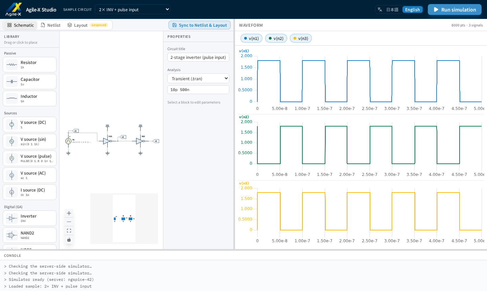

# Your first circuit

In this page you add a third inverter to the sample "2× INV + pulse input", check its waveforms, place and route it on
the gate array, and download the GDS.

When you finish, you can:

- place parts on the schematic, wire them, and carry the change to the netlist and layout;
- simulate with ngspice on the server and read the waveforms;
- inspect the placed and routed layout and download the GDS.

It takes about ten minutes.

## Before you start

Finish [Install](install.md), start `npm run dev` and open <http://localhost:5173>. Check that the console says
`Simulator ready`.

## 1. Open the sample

In **Sample circuit** at the top, choose **2× INV + pulse input**.

The schematic shows a pulse source `V1`, inverters `XU1` and `XU2`, and net labels `n1`, `n2` and `n3`. The
**Netlist** tab shows the same circuit as a SPICE netlist:

```spice
V1 n1 0 PULSE(0 1.8 0 1n 1n 50n 100n)
XU1 n1 n2 VDD 0 INV
XU2 n2 n3 VDD 0 INV
```

## 2. Simulate

Press **Run simulation** at the top right. In a few seconds the waveforms `v(n1)`, `v(n2)` and `v(n3)` appear on the
right.



`v(n2)` is `v(n1)` inverted, and `v(n3)` is inverted again, so it follows `v(n1)`.

- The signal buttons above the plots show or hide each signal.
- Drag horizontally over a plot to zoom into that range; double-click to zoom back out.

## 3. Add an inverter

Go back to the **Schematic** tab.

1. In the library on the left, under **Digital (GA)**, click **Inverter**. An inverter appears on the canvas; drag it
   to the empty space to the right of `XU2`.
2. Under **Other**, place one **VDD** and one **Ground**, above and below the new inverter.
3. Wire them. Click a pin once to start a wire, then click the pin or wire to connect to:
    - the `n3` net label (the output of `XU2`) and the new inverter's `IN`
    - the new inverter's `VDD` and the VDD symbol
    - the new inverter's `VSS` and the Ground symbol
4. Under **Other**, place a **Net label** and connect it to the new inverter's `OUT`. Select the label and set
   **Net name** in the properties on the right to `n4`.

To stop drawing a wire, press Esc, right-click or double-click. To undo a step, press Ctrl+Z (⌘Z on macOS).

After an edit, **modified** appears above the canvas and the Netlist tab shows **unsynced**: the schematic and the
netlist no longer match.

## 4. Sync to the netlist and layout

Press **Sync to Netlist & Layout**.

- The netlist is rebuilt from the schematic and gains a line like `XU3 n3 n4 VDD 0 INV`.
- A layout sync follows, and the three inverters are placed and routed on the gate array.

Press **Run simulation** again: `v(n4)` is now there, the inverse of `v(n3)`.

## 5. Inspect the layout

Open the **Layout** tab. The labels of the placed gates and the METAL5 routes (cyan) are drawn over the base
`base.gds`.

- Zoom with the mouse wheel and drag to pan.
- Double-click, or press the fit button at the top right, to see the whole chip again.
- **Open in new tab** opens the current view as a high-resolution image.

## 6. Download the GDS

The buttons above the layout download the result.

| Button | What you get |
|---|---|
| **Download GDS** | `combined.gds`: `base.gds` with the routes added |
| **Download fab data** | `combined_forfab.gds`: the fabrication base `base_forfab.gds` with the routes added |
| **Print** | the current view on a printable page |

## Next

- [A 4-bit adder across two rows](../tutorials/adder.md): a 36-gate circuit that routes between rows and to the I/O pads.
- [Schematic editor](../guide/schematic.md): the parts and every operation.
- [Netlist](../guide/netlist.md): the rules for writing a circuit as text.
