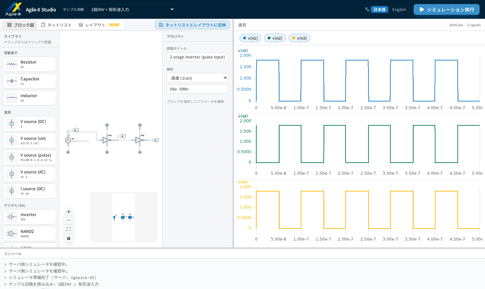

# 最初の回路

このページでは、サンプルの「2段INV + 矩形波入力」にインバータを 1 段足して 3 段にします。そのあと波形を確かめ、ゲートアレイに配置・配線して、GDS をダウンロードするところまで進めます。

終わると、次のことができるようになっています。

- ブロック図に部品を置いて配線し、ネットリストとレイアウトに反映する
- サーバ側の ngspice でシミュレーションして、波形を読む
- 配置・配線したレイアウトを確かめて、GDS を取り出す

所要時間は 10 分ほどです。

## 始める前に

[インストール](install.md) を済ませ、`npm run dev` で起動して <http://localhost:5173> を開いておきます。コンソールに `シミュレータ準備完了` と出ていることを確かめてください。

## 1. サンプルを開く

画面上部の **サンプル回路** で「**2段INV + 矩形波入力**」を選びます。

ブロック図に、パルス電源 `V1`、インバータ `XU1`・`XU2` と、ネットラベル `n1`・`n2`・`n3` が出ます。
**ネットリスト** タブを開くと、同じ回路の SPICE ネットリストが見られます。

```spice
V1 n1 0 PULSE(0 1.8 0 1n 1n 50n 100n)
XU1 n1 n2 VDD 0 INV
XU2 n2 n3 VDD 0 INV
```

## 2. シミュレーションする

右上の **シミュレーション実行** を押します。数秒で右側に `v(n1)`・`v(n2)`・`v(n3)` の波形が出ます。



`v(n2)` は `v(n1)` を反転した波形、`v(n3)` はもう一度反転して `v(n1)` と同じ向きになっています。

- 波形の上の信号名ボタンを押すと、その信号の表示・非表示が切り替わります。
- 波形の上で横にドラッグすると、その範囲を拡大します。ダブルクリックで元に戻ります。

## 3. インバータを 1 段足す

**ブロック図** タブに戻ります。

1. 左のライブラリの **デジタル (GA)** から **Inverter** をクリックします。キャンバスにインバータが 1 つ置かれます。`XU2` の右側の空いた場所までドラッグしてください。
2. **その他** から **VDD** と **Ground** を 1 つずつ置き、新しいインバータの上と下に並べます。
3. 配線します。ピンを 1 回クリックすると配線が始まり、つなぎたいピンか配線をもう 1 回クリックするとつながります。
    - `n3` のネットラベル（`XU2` の出力）と、新しいインバータの `IN`
    - 新しいインバータの `VDD` と、VDD 記号
    - 新しいインバータの `VSS` と、Ground 記号
4. **その他** から **Net label** を置いて、新しいインバータの `OUT` につなぎます。ネットラベルを選んで、右のプロパティの **ネット名** を `n4` にします。

配線を途中でやめるときは、Esc キー、右クリック、ダブルクリックのどれかを使います。間違えたら Ctrl+Z（macOS は ⌘Z）で 1 手戻せます。

編集すると、タブの上に **変更あり**、ネットリストタブに **未同期** と出ます。ブロック図とネットリストがずれている、という意味です。

## 4. ネットリストとレイアウトに反映する

**ネットリストとレイアウトに反映** を押します。

- ネットリストがブロック図から作り直され、`XU3 n3 n4 VDD 0 INV` のような行が増えます。
- 続けてレイアウトの同期が走り、3 つのインバータがゲートアレイに配置・配線されます。

もう一度 **シミュレーション実行** を押すと、`v(n4)` が増えています。`v(n4)` は `v(n3)` を反転した波形です。

## 5. レイアウトを確かめる

**レイアウト** タブを開きます。ベースの `base.gds` の上に、配置したゲートのラベルと METAL5 の配線（水色）が重なって表示されます。

- マウスホイールで拡大・縮小、ドラッグで移動します。
- ダブルクリックするか、右上の全体表示ボタンを押すと、チップ全体に戻ります。
- **新しいタブで開く** を押すと、今の表示を高解像度の画像で開きます。

## 6. GDS をダウンロードする

レイアウトタブの上のボタンで、結果をダウンロードできます。

| ボタン | ダウンロードされるもの |
|---|---|
| **GDS ダウンロード** | `combined.gds`: `base.gds` に配線を重ねたもの |
| **製造データダウンロード** | `combined_forfab.gds`: 製造用のベース `base_forfab.gds` に配線を重ねたもの |
| **印刷** | 今の表示を印刷用のページで開く |

## 次に読むもの

- [2 行にまたがる 4 ビット加算器](../tutorials/adder.md): 36 ゲートの回路で、行をまたぐ配線と I/O パッドを使います。
- [ブロック図エディタ](../guide/schematic.md): 部品と操作の一覧です。
- [ネットリスト](../guide/netlist.md): テキストで回路を書くときの決まりです。
