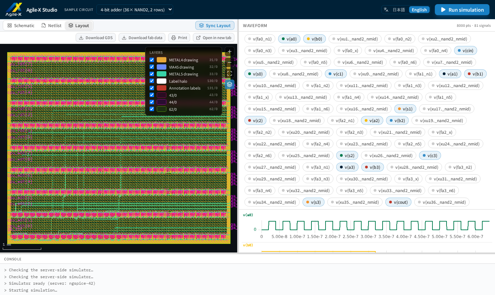

# Layout

The **Layout** tab shows the netlist's gates placed and routed on the gate array, drawn over the base `base.gds`.
The layout is always rebuilt from the netlist; there is no way to edit shapes by hand.

## Building the layout

Two buttons build the layout:

| Button | Where | Netlist used |
|---|---|---|
| **Sync to Netlist & Layout** | Schematic tab | the netlist rebuilt from the schematic |
| **Sync Layout** | Layout tab | the current text in the Netlist tab |

When the netlist has changed since the last layout, the Layout tab shows **unsynced**.

A sync takes from a few seconds to a few tens of seconds, depending on the size of the circuit.

## How placement and routing work

1. **Extract the gates**: the `INV`, `NAND2`, `NOR2` and `Z__GABASECELL` lines are taken from the netlist
   ([lines placed on the gate array](netlist.md)).
2. **Place**: each gate gets one base cell.
    - A row has 35 sites. A larger circuit is split evenly over as many rows as it needs, in consecutive rows.
    - Rows alternate direction (the first left to right, the second right to left, …), so gates that connect across
      row ends sit close together.
    - An arrangement ordered by connectivity, which keeps closely connected gates together, is tried as well.
3. **Route**: nets are drawn one at a time in METAL5 on a 10 µm grid.
    - A net that stays within one row uses the routing tracks inside the row.
    - A net that crosses rows or goes to an I/O pad leaves from the top or bottom end of a pin (Y = 5 / 145 µm) and
      runs between the rows.
    - When it goes vertically, it passes over horizontal wires using the **jumpers** built into the base (see below).
    - Supply pins connect to each row's VDD / VSS rails.
4. **I/O pads**: nets named in `GA_IO` lines are routed to the I/O pads on the right edge of the chip.
5. **Verify**: shorts, opens and spacing are checked from the shapes to be written out (see below).
6. **Retry**: if placement or routing fails, or verification does not pass, the placement is changed and everything
   is tried again.
7. **Write**: the routes go to `schematic_overlay.gds`, which is merged with `base.gds` and `base_forfab.gds`.

### Jumpers

The base has lower-metal jumpers for passing over METAL5 wires.

| Jumper | Where | What it connects |
|---|---|---|
| `JUMPLINE2` | inside each base cell, 8 columns | the pads at the bottom (Y = 5 µm) and top (Y = 145 µm) of the cell: jumps over a row |
| `JUMPLINE1` | between rows (the 430 µm gap) | two pads 40 µm apart: jumps over wires crossing the gap |

A route that enters one pad of a free jumper can leave from its other pad. Both ends of a used jumper belong to that
net, so it never connects to another net. This keeps the horizontal tracks free in circuits with many routes between
rows.

Dimensions are in [Gate array](../reference/gate-array.md#jumpers).

### Verification

After routing, the connectivity is rebuilt from the output shapes alone; nothing from the router's own bookkeeping is
used.

- Input: the METAL5 rectangles to be written, and the METAL5 pads of `base.gds` (pins, jumpers, supply rails, I/O pads)
- Shapes that touch are merged into one net.
- The result is discarded if it has:
    - **a short**: two different nets connected
    - **an open**: pins or I/O pads of one net not connected, or a supply pin not on its rail
    - **a spacing violation**: shapes of different nets less than 5 µm apart

## The viewer

The API server draws the layout into PNG tiles with the [KLayout](https://www.klayout.de/) Python module, and the
browser lays the tiles out (the same approach as [Undine](https://github.com/kadomoto-lab/undine-eda)). Zooming loads
tiles drawn for the new scale; while they load, coarser tiles or the tiles from before the last sync fill in.

| Action | How |
|---|---|
| Zoom | mouse wheel, or **+** / **−** at the top right |
| Pan | drag |
| Fit the whole chip | double-click, or the fit button at the top right |
| Show or hide layers | the panel opened by the layers button at the top right |
| Read coordinates | the cursor position (µm) and a scale bar appear at the bottom left |
| View on a full page | **Open in new tab** (opens the current view as a high-resolution image) |

Syncing the layout again keeps the current zoom and position. Before the first sync, only `base.gds` is shown.

The layers shown are METAL4 (31/0), VIA45 (32/0), METAL5 (33/0), the gate-label layers (130/0, 131/0) and the other
layers in `base.gds`. Their colors come from `server/data/layers.lyp` (a KLayout layer properties file).

## Downloads

| Button | File | Contents |
|---|---|---|
| **Download GDS** | `combined.gds` | `base.gds` + routes and labels |
| **Download fab data** | `combined_forfab.gds` | the fabrication base `base_forfab.gds` + routes and labels |
| **Print** | | the current view as a high-resolution image on a printable page (popups must be allowed) |

`base_forfab.gds` has its origin at the center of the chip, so `combined_forfab.gds` shifts the routes by
(−2900, −2900) µm.

The generated files are in `public/generated/`:

| File | Contents |
|---|---|
| `schematic_overlay.gds` | routes and labels only |
| `combined.gds` | merged with `base.gds` |
| `combined_forfab.gds` | merged with `base_forfab.gds` |

## When a sync fails { #sync-errors }

A failure shows its reason above the layout, for example `Layout sync failed (HTTP 422): ...`.

| Reason | What to do |
|---|---|
| `no gate-array sites available` | more than 315 gates; make the circuit smaller |
| `maze routing failed (<net>: ...)` | routing is too congested; revisit the connections or change the order of the gates |
| `verification failed: ...` | no attempt passed verification; this is most likely a bug, please report it with the netlist |
| `invalid GA_IO line (...)` | a `GA_IO` line whose direction is not `IN` / `OUT`, or whose pad number is outside 0–12 |
| `GA_IO pad IN 0 is assigned twice` | two nets assigned to the same pad |

Placement and routing failures read `GA layout sync failed after 72 attempts: ...`, where `...` is the reason for the
last attempt; for a routing failure it names the net and the pins that could not be connected.
