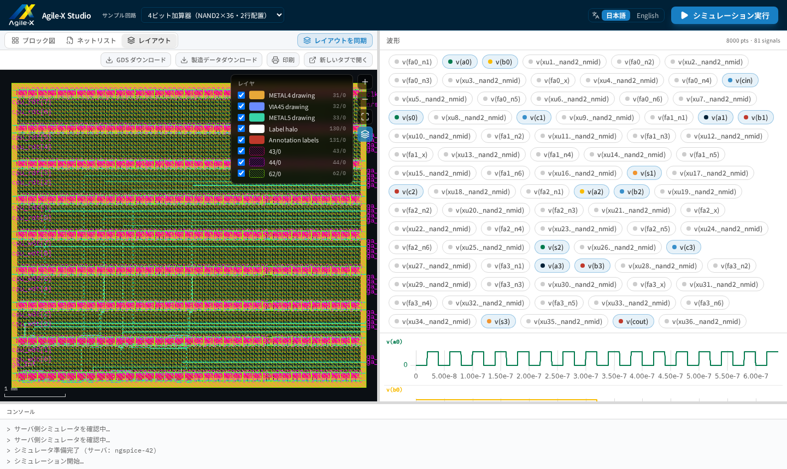

# レイアウト

**レイアウト** タブでは、ネットリストのゲートをゲートアレイに配置・配線した結果を、ベースの `base.gds` に重ねて表示します。レイアウトは常にネットリストから作り直します。手で図形を編集する機能はありません。

## レイアウトを作る

レイアウトを作るボタンは 2 つあります。

| ボタン | 場所 | 使うネットリスト |
|---|---|---|
| **ネットリストとレイアウトに反映** | ブロック図タブ | ブロック図から作り直したネットリスト |
| **レイアウトを同期** | レイアウトタブ | ネットリストタブの今のテキスト |

ネットリストを変えてからレイアウトを作り直していないときは、レイアウトタブに **未同期** と出ます。

同期にかかる時間は、回路の大きさによって数秒から数十秒です。

## 配置・配線の流れ

1. **ゲートを取り出す**: ネットリストから `INV`・`NAND2`・`NOR2`・`Z__GABASECELL` の行を取り出します（[ゲートアレイに置かれる行](netlist.md)）。
2. **配置**: ゲートを 1 個ずつベースセルに割り当てます。
    - 1 行は 35 サイトです。ゲートが多いときは必要な行数に均等に分け、連続した行に並べます。
    - 行ごとに並ぶ向きを交互にします（1 行目は左から右、2 行目は右から左…）。行の端でつながるゲートが近くに来ます。
    - つながりの強いゲートが近くに来るよう、接続順に並べた配置も試します。
3. **配線**: 10 µm 格子の上で、ネットを 1 本ずつ METAL5 で引きます。
    - 同じ行の中だけで閉じるネットは、行の中の配線トラックを使います。
    - 行をまたぐネットと I/O パッドにつながるネットは、ピンの上下端（Y = 5 / 145 µm）から出て、行の間を通ります。
    - 縦に進むとき、ベースに組み込まれた **ジャンパ** で横方向の配線を飛び越えます（下の節）。
    - 電源ピンは、行ごとの VDD / VSS 配線につなぎます。
4. **I/O パッド**: `GA_IO` で指定したネットを、チップ右端の I/O パッドまで引きます。
5. **検証**: 出力する図形だけを使って、ショート・オープン・間隔違反がないか確かめます（下の節）。
6. **やり直し**: 配置や配線に失敗したとき、または検証が通らなかったときは、配置を変えてやり直します。
7. **書き出し**: 配線を `schematic_overlay.gds` に書き、`base.gds`・`base_forfab.gds` と重ねた GDS を作ります。

### ジャンパ

ベースには、METAL5 の配線を飛び越えるための下層メタルのジャンパが組み込まれています。

| ジャンパ | 場所 | つなぐもの |
|---|---|---|
| `JUMPLINE2` | 各ベースセルの中、8 列 | セルの下端（Y = 5 µm）と上端（Y = 145 µm）のパッド。行を縦に飛び越える |
| `JUMPLINE1` | 行と行の間（430 µm の隙間） | 40 µm 離れた 2 つのパッド。隙間を横切る配線をまたぐ |

配線は、空いているジャンパの片側のパッドに入ると、反対側のパッドから出られます。使ったジャンパは両端ともそのネットのものになるので、ほかのネットとはつながりません。これにより、行をまたぐ配線が多い回路でも、横方向の配線トラックを塞がずに済みます。

寸法は [ゲートアレイ](../reference/gate-array.md#jumpers) を参照してください。

### 検証

配線が終わると、出力する図形から接続を組み立て直して確かめます。配線の途中の情報は使いません。

- 材料: 出力する METAL5 の矩形と、`base.gds` の METAL5 パッド（ピン、ジャンパ、電源配線、I/O パッド）
- 触れている図形同士を同じネットとしてまとめます。
- 次のどれかがあれば、その結果は使いません。
    - **ショート**: 違うネット同士がつながっている
    - **オープン**: 同じネットのピンや I/O パッドが途切れている、電源ピンが電源配線につながっていない
    - **間隔**: 違うネットの図形の間隔が 5 µm 未満

## ビューア

レイアウトは API サーバが [KLayout](https://www.klayout.de/) の Python モジュールで PNG のタイルに描き、ブラウザはそれを並べて表示します（[Undine](https://github.com/kadomoto-lab/undine-eda) と同じ方式）。拡大すると、その倍率のタイルを読み直します。読み込み中は、粗いタイルや同期前のタイルで仮に埋めます。

| 操作 | 方法 |
|---|---|
| 拡大・縮小 | マウスホイール、または右上の **＋** / **−** |
| 移動 | ドラッグ |
| 全体表示 | ダブルクリック、または右上の全体表示ボタン |
| レイヤの表示切り替え | 右上のレイヤボタンで開くパネル |
| 座標を見る | 左下にカーソル位置（µm）とスケールバーが出ます |
| 大きな画面で見る | **新しいタブで開く**（今の表示を高解像度の画像で開く） |

レイアウトを同期し直しても、拡大位置はそのまま保たれます。まだ一度も同期していないときは、`base.gds` だけを表示します。

表示する層は METAL4（31/0）、VIA45（32/0）、METAL5（33/0）、ゲートのラベル用の層（130/0、131/0）と、`base.gds` にあるほかの層です。色は `server/data/layers.lyp`（KLayout のレイヤ設定ファイル）で決めています。

## ダウンロード

| ボタン | ファイル | 中身 |
|---|---|---|
| **GDS ダウンロード** | `combined.gds` | `base.gds` + 配線とラベル |
| **製造データダウンロード** | `combined_forfab.gds` | 製造用のベース `base_forfab.gds` + 配線とラベル |
| **印刷** | | 今の表示を高解像度の画像にして、印刷用のページで開く（ポップアップの許可が必要） |

`base_forfab.gds` は座標の原点がチップ中央にあるため、`combined_forfab.gds` では配線を (−2900, −2900) µm ずらして重ねています。

生成したファイルは `public/generated/` に置かれます。

| ファイル | 中身 |
|---|---|
| `schematic_overlay.gds` | 配線とラベルだけ |
| `combined.gds` | `base.gds` と重ねたもの |
| `combined_forfab.gds` | `base_forfab.gds` と重ねたもの |

## 同期に失敗したとき { #sync-errors }

失敗すると、レイアウトタブの上に `レイアウト同期失敗 (HTTP 422): ...` のように理由が出ます。

| 理由 | 対処 |
|---|---|
| `no gate-array sites available` | ゲートが 315 個より多い。回路を小さくする |
| `maze routing failed (<ネット>: ...)` | 配線が混みすぎている。ネットのつながりを見直すか、ゲートの並び順を変える |
| `verification failed: ...` | どの試行でも検証が通らなかった。不具合の可能性が高いので、ネットリストを添えて報告してください |
| `invalid GA_IO line (...)` | `GA_IO` 行の方向が `IN` / `OUT` でない、またはパッド番号が 0〜12 の範囲外 |
| `GA_IO pad IN 0 is assigned twice` | 同じパッドに 2 つのネットを割り当てている |

配置・配線の失敗は `GA layout sync failed after 72 attempts: ...` の形で出ます。`...` の部分は最後の試行で失敗した理由で、配線の失敗ならつなげなかったネットとピンが入っています。
