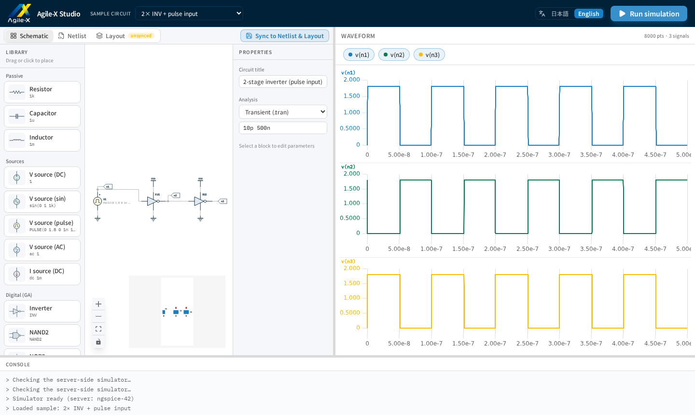

# Schematic editor

In the **Schematic** tab you place parts and wire them. **Sync to Netlist & Layout** writes the circuit out as a SPICE
netlist and builds the gate-array layout from it.

The screen has three columns: the library, the canvas and the properties.

## Place parts

Drag a part from the library onto the canvas, or click it to drop it in an empty area. Parts snap to the grid.

| Group | Part | Default | In the netlist |
|---|---|---|---|
| Passive | Resistor / Capacitor / Inductor | `1k` / `1u` / `1m` | `R1 a b 1k` etc. |
| Sources | V source (DC) | `1` | `V1 a b dc 1` |
| | V source (sin) | `sin(0 1 1k)` | `V1 a b sin(0 1 1k)` |
| | V source (pulse) | `PULSE(0 1.8 0 1n 1n 0.5u 1u)` | `V1 a b PULSE(...)` |
| | V source (AC) | `ac 1` | `V1 a b ac 1` |
| | I source (DC) | `dc 1m` | `I1 a b dc 1m` |
| Digital (GA) | Inverter / NAND2 / NOR2 | | `XU1 in out VDD 0 INV` etc. (placed on the gate array) |
| | NMOS / PMOS / MOS Cap | | a single transistor or MOS capacitor (simulation only) |
| | GA Base Cell | | `Z__GABASECELL` used directly (placed on the gate array) |
| Other | Ground | | net `0` |
| | VDD | `1.8` | net `VDD` and the source `VVDD VDD 0 dc 1.8` |
| | Net label | `net1` | names a net |
| | Input / Output | pad `0` | `* GA_IO IN 0 <net>` / `* GA_IO OUT 0 <net>` |

If the schematic has any Digital (GA) part, the netlist starts with the base cell's subcircuit definitions and
transistor models. See [Netlist](netlist.md#preamble).

## Wire

1. Click a pin to start a wire (no need to hold the button).
2. Click the target pin or an existing wire to connect. Clicking empty space keeps the wire going.
3. To stop, press Esc, right-click or double-click.

Wire paths are chosen automatically: they avoid other nets, and junctions get a dot.

## Net names

- **Net label**, **Ground** and **VDD** name the net they are connected to. Ground is `0` and VDD is `VDD`.
- **Symbols with the same name are the same net, even without a wire between them.** All `VDD` symbols, and all net
  labels with the same name, are connected.
- Nets without a name get automatic names: `n10`, `n11`, …

## Properties

Select a part to see its settings on the right.

| Field | For | Meaning |
|---|---|---|
| Ref | all parts | The reference name (`R1`, `V1`, `U1`, …). Digital (GA) parts get an `X` in front in the netlist (`U1` → `XU1`) |
| Value | passives and sources | The value, written as in SPICE (`10k`, `PULSE(...)`, …) |
| Voltage (V) | VDD | The supply voltage |
| Subckt / SPICE | Digital (GA) | The subcircuit name, and a preview of the line written out |
| Net name | Net label | The name of the net |
| Flip (pin on the right) | Net label | Put the pin on the right side |
| Pad (ga_in / ga_out) | Input / Output | The I/O pad number (0–12) |
| Delete | all parts | Delete the part |

With nothing selected, the panel shows the circuit's settings:

| Field | Meaning |
|---|---|
| Circuit title | Becomes the first line (the title line) of the netlist |
| Analysis | Transient (`.tran`), AC (`.ac`) or Operating point (`.op`), and its parameters (e.g. `10p 50n`, `dec 10 1 1meg`) |

## Select, delete, undo

| Action | How |
|---|---|
| Select | click the part away from its pins (clicking a pin starts a wire) |
| Delete | select, then Delete or Backspace, or **Delete** in the properties |
| Undo | Ctrl+Z (⌘Z on macOS) |
| Redo | Ctrl+Y or Ctrl+Shift+Z (⌘⇧Z on macOS) |
| Zoom, fit | mouse wheel, or the buttons at the bottom left |

Consecutive edits of the same kind (such as typing in a property, one character at a time) undo as one step.

## Keeping the schematic and netlist in step

You can edit either the schematic or the netlist.

| When you | What happens |
|---|---|
| edit the schematic | **modified** appears above the canvas and **unsynced** on the Netlist tab |
| press **Sync to Netlist & Layout** | the netlist is rebuilt from the schematic, then the layout is synced |
| edit in the Netlist tab | the schematic is rebuilt from as much of the netlist as it can read |
| choose a sample circuit | both the schematic and the netlist are replaced |

!!! warning "Syncing rewrites the netlist"
    **Sync to Netlist & Layout** replaces the current netlist with one generated from the schematic. Comments you wrote
    by hand, and lines the schematic cannot represent (`.meas`, `.control`, …), are lost. When you use such lines,
    edit in the Netlist tab and build the layout with **Sync Layout** in the Layout tab.
