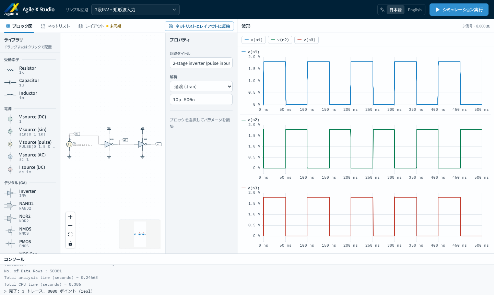

# ブロック図エディタ

**ブロック図** タブでは、部品を並べて配線し、回路を描きます。描いた回路は
**ネットリストとレイアウトに反映** で SPICE ネットリストに書き出され、そのままゲートアレイのレイアウトも作られます。

画面は左から、ライブラリ、キャンバス、プロパティの 3 列です。

## 部品を置く

ライブラリの部品をキャンバスへドラッグするか、クリックします。クリックしたときは、キャンバスの空いたあたりに置かれます。部品の位置はグリッドに揃います。

| 分類 | 部品 | 既定値 | ネットリストでの形 |
|---|---|---|---|
| 受動素子 | Resistor / Capacitor / Inductor | `1k` / `1u` / `1m` | `R1 a b 1k` など |
| 電源 | V source (DC) | `1` | `V1 a b dc 1` |
| | V source (sin) | `sin(0 1 1k)` | `V1 a b sin(0 1 1k)` |
| | V source (pulse) | `PULSE(0 1.8 0 1n 1n 0.5u 1u)` | `V1 a b PULSE(...)` |
| | V source (AC) | `ac 1` | `V1 a b ac 1` |
| | I source (DC) | `dc 1m` | `I1 a b dc 1m` |
| デジタル (GA) | Inverter / NAND2 / NOR2 | | `XU1 in out VDD 0 INV` など（ゲートアレイに配置） |
| | NMOS / PMOS / MOS Cap | | 単体のトランジスタと MOS 容量（シミュレーションのみ） |
| | GA Base Cell | | `Z__GABASECELL` をそのまま使う（ゲートアレイに配置） |
| その他 | Ground | | ネット `0` |
| | VDD | `1.8` | ネット `VDD` と、電源 `VVDD VDD 0 dc 1.8` |
| | Net label | `net1` | ネットに名前をつける |
| | Input / Output | パッド `0` | `* GA_IO IN 0 <ネット>` / `* GA_IO OUT 0 <ネット>` |

デジタル (GA) の部品が 1 つでもあると、ネットリストの先頭にベースセルのサブサーキット定義とトランジスタモデルが入ります。中身は [ネットリスト](netlist.md#preamble) を参照してください。

## 配線する

1. 部品のピンをクリックすると、配線が始まります（ボタンを押し続ける必要はありません）。
2. つなぎたい先のピンか、既存の配線をクリックすると、つながります。何もないところをクリックしても配線は続きます。
3. 配線をやめるときは、Esc キー、右クリック、ダブルクリックのどれかを使います。

配線の経路は自動で決まります。ほかのネットとの重なりを避け、接続点には丸印がつきます。

## ネットの名前

- **Net label**、**Ground**、**VDD** の記号は、つないだネットに名前をつけます。Ground は `0`、VDD は `VDD` です。
- **同じ名前の記号は、配線がなくても同じネットになります。** 離れた場所の `VDD` 記号や、同じ名前のネットラベルは、互いにつながっています。
- 名前のないネットには、`n10`、`n11`… のように自動で名前がつきます。

## プロパティ

部品を選ぶと、右のプロパティに設定が出ます。

| 項目 | 対象 | 内容 |
|---|---|---|
| Ref | すべての部品 | 参照名（`R1`、`V1`、`U1` など）。デジタル (GA) の部品はネットリストで先頭に `X` がつきます（`U1` → `XU1`） |
| Value | 受動素子・電源 | 値。SPICE の書き方そのままです（`10k`、`PULSE(...)` など） |
| Voltage (V) | VDD | 電源電圧 |
| Subckt / SPICE | デジタル (GA) | 使うサブサーキット名と、書き出される行の見本 |
| ネット名 | Net label | ネットの名前 |
| 左右反転 | Net label | ピンを右側にする |
| パッド (ga_in / ga_out) | Input / Output | I/O パッドの番号（0〜12） |
| 削除 | すべての部品 | 部品を削除する |

何も選んでいないときは、回路全体の設定が出ます。

| 項目 | 内容 |
|---|---|
| 回路タイトル | ネットリストの 1 行目（タイトル行）になります |
| 解析 | 過渡 (`.tran`)、AC (`.ac`)、動作点 (`.op`) と、そのパラメータ（例: `10p 50n`、`dec 10 1 1meg`） |

## 選択・削除・取り消し

| 操作 | 方法 |
|---|---|
| 選択 | ピン以外の部分をクリック（ピンをクリックすると配線が始まります） |
| 削除 | 選んで Delete か Backspace、またはプロパティの **削除** |
| 取り消し | Ctrl+Z（macOS は ⌘Z） |
| やり直し | Ctrl+Y、Ctrl+Shift+Z（macOS は ⌘⇧Z） |
| 拡大・縮小・全体表示 | マウスホイール、または左下のボタン |

続けて行った同じ種類の編集（プロパティの 1 文字ごとの入力など）は、まとめて 1 手として取り消されます。

## ローカルに保存・インポート

ブロック図タブの **ローカルに保存** を押し、ファイル名を入力して **保存** すると、`.json` ファイルをダウンロードします。部品の種類・配置・プロパティ、配線の接続、回路タイトル、解析設定が保存されます。編集中で未同期の図も保存できます。保存先はブラウザのダウンロード設定に従います。場所を選ぶには、保存先を毎回確認する設定を有効にしてください。

**ファイルを読み込む** で保存したファイルを選ぶと、現在のブロック図を置き換え、全体が見える表示に戻します。取り消し（Ctrl+Z / ⌘Z）で読み込み前の図に戻せます。対応していないファイルや壊れたファイルはエラーになり、現在の図は変わりません。

保存するJSON内の回路タイトルには、ファイル名から `.json` を除いた名前が入ります。

インポート後、ネットリストとレイアウトを更新するには **ネットリストとレイアウトに反映** を押してください。保存ファイルには手書きのネットリスト、シミュレーション結果、生成済み GDS は含まれません。

## ネットリストとの同期

ブロック図とネットリストは、どちらからでも編集できます。

| 操作 | 何が起きるか |
|---|---|
| ブロック図を編集する | タブに **変更あり**、ネットリストタブに **未同期** と出ます |
| **ネットリストとレイアウトに反映** を押す | ブロック図からネットリストを作り直し、続けてレイアウトを同期します |
| ネットリストタブで編集する | 読み取れる範囲でブロック図を作り直します |
| サンプル回路を選ぶ | ブロック図とネットリストの両方を差し替えます |

!!! warning "反映するとネットリストは書き直されます"
    **ネットリストとレイアウトに反映** は、ブロック図から作ったネットリストで今のネットリストを置き換えます。ネットリストに手で書いたコメントや、ブロック図で表せない行（`.meas`、`.control` など）は残りません。そうした行を使うときは、ネットリストタブで編集し、レイアウトはレイアウトタブの **レイアウトを同期** で作ってください。
