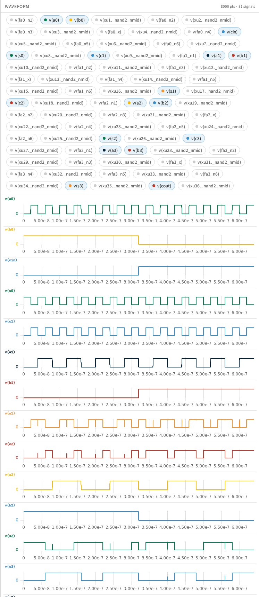

# Simulation

**Run simulation** sends the current netlist to the API server, where ngspice computes it. The waveforms appear on the
right and ngspice's log in the console at the bottom.

## What happens

1. The browser sends the netlist to `POST /api/simulate`.
2. The API server creates a temporary directory and runs `ngspice -b -o log.txt -r out.raw netlist.cir`. ngspice's
   settings file (`.spiceinit`) is not read, so the machine's configuration does not change the result.
3. It reads the `.raw` file written, turns the last sweep (time for `.tran`, frequency for `.ac`) into JSON and
   returns it.
4. The browser draws the waveforms and prints the log in the console.

While a simulation runs you can keep working, for example sync the layout.

## Reading the waveforms



- Each signal has its own plot; all plots share the horizontal axis.
- The signal buttons at the top show or hide each signal. A new result shows all signals again.
- Drag horizontally over a plot to zoom into that range; double-click to zoom back out.
- These signals are left out: `v(vdd)`, `v(0)`, the current of the VDD source, and signals that never change.
- `.ac` results show the magnitude of the complex values.

## Points and time limit

| Setting | Default | Change it with |
|---|---|---|
| Maximum points shown | 8000 | environment variable `AGILEX_SIM_MAX_POINTS` |
| Time limit | 120 s | environment variable `AGILEX_SIM_TIMEOUT` (seconds) |
| Netlist size | up to 2 MB | fixed |

When ngspice produces more points than the maximum, they are thinned out at even intervals. The `plot:` line in the
console shows the count before thinning. To see fine detail, simulate a shorter time range.

When the time limit is reached, ngspice is stopped and the console shows `simulation timed out after 120 s`.

## Measurements (`.meas`)

A netlist with `.meas` lines runs as it is, and the measured values appear in the console.

```spice
.tran 10u 5m
.meas tran vmax MAX v(out)
```

```text
vmax                =  9.932623e-01 at=  5.000000e-03
```

## `.control` blocks

A netlist with a `.control` … `.endc` block runs as an ngspice script (`quit` is added at the end). To get
waveforms, write a `.raw` file inside the block:

```spice
.control
tran 10u 5m
write out.raw
.endc
```

!!! warning "Commands that are refused"
    So that the server never runs arbitrary programs, `shell`, `exec` and `system` are not accepted inside
    `.control`. A netlist containing them is rejected with HTTP 400.

## When something goes wrong

ngspice's errors appear in the console as lines starting with `ERROR:`.

| Message | Common cause |
|---|---|
| `ERROR: unknown subckt: ...` | the preamble (subcircuit definitions) is missing, or a name is misspelled |
| `ERROR: Simulation returned no waveform data` | no analysis command, or a `.control` block that writes no `.raw` |
| `ERROR: No plottable signals in simulation result` | only `.op`, or every signal is constant |
| `Cannot reach the simulation API` | the API server is not running |

For other symptoms, see [Troubleshooting](../troubleshooting.md).
