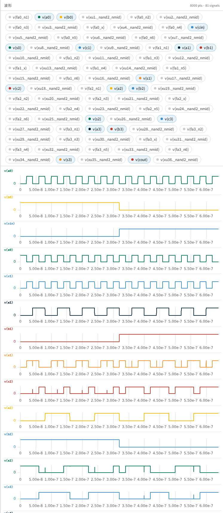

# シミュレーション

**シミュレーション実行** を押すと、今のネットリストが API サーバに送られ、サーバ側の ngspice で計算されます。結果の波形は右側に、ngspice のログは下のコンソールに出ます。

## 実行の流れ

1. ブラウザが `POST /api/simulate` にネットリストを送ります。
2. API サーバは一時ディレクトリを作り、`ngspice -b -o log.txt -r out.raw netlist.cir` を実行します。ngspice の設定ファイル（`.spiceinit`）は読まないので、マシンの設定に結果が左右されません。
3. 書き出された `.raw` ファイルを読み、最後の掃引結果（`.tran` なら時間、`.ac` なら周波数）を JSON にして返します。
4. ブラウザが波形を描き、ログをコンソールに出します。

実行中も、ほかの操作（レイアウトの同期など）はできます。

## 波形の見方



- 信号は 1 本ずつ別のグラフに出ます。横軸は全グラフで揃っています。
- 上の信号名ボタンで、表示・非表示を切り替えます。新しい結果が来ると、全信号が表示に戻ります。
- グラフの上で横にドラッグすると、その範囲を拡大します。ダブルクリックで元に戻ります。
- 次の信号は最初から出しません: `v(vdd)`、`v(0)`、VDD 電源の電流、値がまったく変わらない信号。
- `.ac` の結果は、複素数の絶対値（`|V|`）を表示します。

## CSVダウンロード

波形欄の **CSVダウンロード** で、解析結果を `waveform.csv` に保存できます。表示・非表示や拡大範囲によらず、サーバから返された全信号・全データ点を出力します。列名には単位が入り、AC解析の複素数は実部（`.real`）と虚部（`.imag`）を別列に出力します。

## 点数とタイムアウト

| 項目 | 既定値 | 変え方 |
|---|---|---|
| 表示する最大点数 | 8000 点 | 環境変数 `AGILEX_SIM_MAX_POINTS` |
| タイムアウト | 120 秒 | 環境変数 `AGILEX_SIM_TIMEOUT`（秒） |
| ネットリストの大きさ | 2 MB まで | 変えられません |

ngspice が出した点数が最大点数より多いときは、等間隔に間引いて返します。コンソールの `plot:` の行に、間引く前の点数が出ます。細かい波形を見たいときは、解析の時間範囲を狭めてください。

タイムアウトすると ngspice を止め、コンソールに `simulation timed out after 120 s` と出ます。

## 測定（`.meas`）

`.meas` を書いたネットリストは、そのまま実行できます。測定値はコンソールに出ます。

```spice
.tran 10u 5m
.meas tran vmax MAX v(out)
```

```text
vmax                =  9.932623e-01 at=  5.000000e-03
```

## `.control` ブロック

`.control` 〜 `.endc` を書いたネットリストは、ngspice のスクリプトとして実行します（最後に `quit` を自動で足します）。波形を表示するには、ブロックの中で `.raw` ファイルを書き出してください。

```spice
.control
tran 10u 5m
write out.raw
.endc
```

!!! warning "使えないコマンド"
    サーバで任意のプログラムが動かないよう、`.control` の中の `shell`・`exec`・`system` は受け付けません。これらを含むネットリストは HTTP 400 で拒否されます。

## エラーが出たとき

ngspice のエラーは、コンソールに `ERROR:` で始まる行として出ます。

| 表示 | よくある原因 |
|---|---|
| `ERROR: unknown subckt: ...` | プリアンブル（サブサーキット定義）がない、または名前の打ち間違い |
| `ERROR: Simulation returned no waveform data` | 解析コマンドがない、または `.control` で `.raw` を書き出していない |
| `ERROR: No plottable signals in simulation result` | `.op` だけ、または全信号が一定 |
| `シミュレーション API に接続できません` | API サーバが起動していない |

ほかの症状は [トラブルシューティング](../troubleshooting.md) を参照してください。
