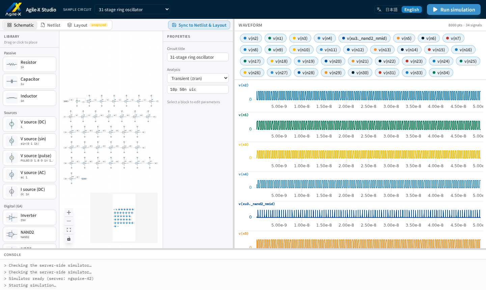

---
hide:
  - toc
---

# Agile-X Studio

**A browser-based circuit design, simulation and layout environment for the Agile-X gate array.**

Draw a circuit as a schematic or a netlist, simulate it with ngspice on the server, and place and route the same circuit
on the gate array automatically. The result downloads as a GDS file ready for fabrication.

[Install](getting-started/install.md){ .md-button .md-button--primary }
[Your first circuit](getting-started/first-circuit.md){ .md-button }

<figure markdown>

<figcaption>The 31-stage ring oscillator sample: the schematic on the left, waveforms computed by ngspice on the server on the right.</figcaption>
</figure>

## Explore the documentation

-   :material-rocket-launch-outline: **[Install](getting-started/install.md)**

    Set up Node.js, Python and ngspice, then start the development servers.

-   :material-school-outline: **[Your first circuit](getting-started/first-circuit.md)**

    Extend a two-stage inverter chain and take it through simulation and layout.

-   :material-chip: **[A 4-bit adder](tutorials/adder.md)**

    36 gates across two rows: routing between rows and to the I/O pads.

-   :material-vector-polyline: **[Schematic editor](guide/schematic.md)**

    Placing parts, wiring, net labels, I/O pads, undo.

-   :material-file-code-outline: **[Netlist](guide/netlist.md)**

    The subcircuits you can use, `GA_IO` lines, analysis commands.

-   :material-sine-wave: **[Simulation](guide/simulation.md)**

    Running ngspice on the server, reading waveforms, `.meas` and `.control`.

-   :material-layers-outline: **[Layout](guide/layout.md)**

    Placement and routing on the gate array, jumpers, verification, GDS downloads.

-   :material-book-open-variant: **[Reference](reference/gate-array.md)**

    Gate-array dimensions, the HTTP API, commands and environment variables.

## Features

**From schematic to GDS in the browser**
:   Schematic, netlist, waveforms and layout share one screen. Edits to the schematic carry over to the netlist and
    the layout.

**Simulation on the server**
:   ngspice runs in batch mode on the API server. The browser only draws the waveforms, so large circuits do not slow
    it down.

**Automatic placement and routing on the gate array**
:   INV, NAND2 and NOR2 gates go onto 9 rows × 35 columns of base cells and are routed in METAL5. Routes between rows
    use the jumpers built into the base. Each result is verified from the shapes that are written out, and a result
    with a short, an open or a spacing violation is never used.

**Japanese and English**
:   Switch the interface language at any time with the toggle at the top right.

## Help

- [Troubleshooting and FAQ](troubleshooting.md)
- [Report a problem](https://github.com/kadomoto-lab/agile-x-studio/issues)
- [Architecture and development](development.md)
- [Licenses](licenses.md)
