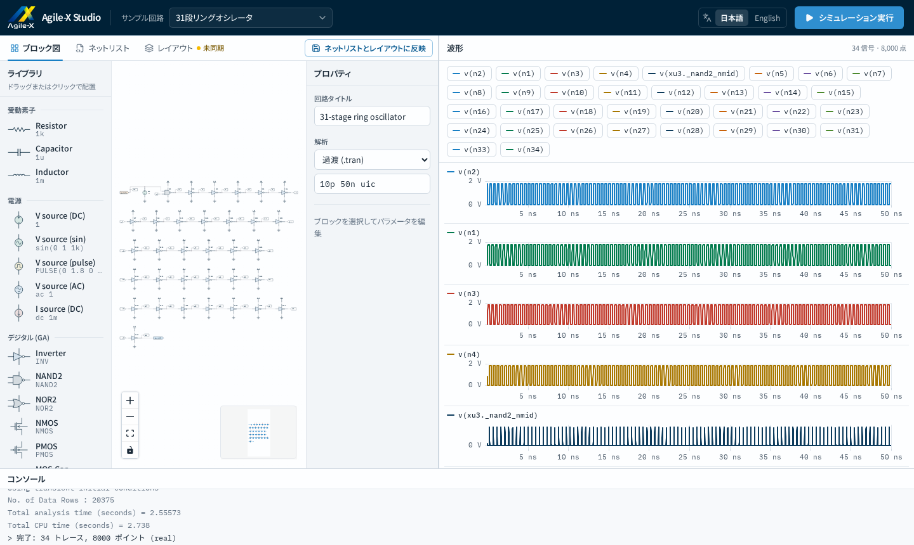

---
hide:
  - toc
---

# Agile-X Studio

**[Agile-X](https://www.agile-x.t.u-tokyo.ac.jp/) ゲートアレイ向けの、ブラウザで使う回路設計・シミュレーション・レイアウト環境です。**

ブロック図またはネットリストで回路を描き、サーバ側の ngspice でシミュレーションして、同じ回路をゲートアレイ上に自動で配置・配線します。結果は製造用の GDS としてダウンロードできます。

[インストール](getting-started/install.md){ .md-button .md-button--primary }
[最初の回路](getting-started/first-circuit.md){ .md-button }

<figure markdown>

<figcaption>サンプルの 31 段リングオシレータ。左がブロック図、右がサーバ側 ngspice で計算した波形です。</figcaption>
</figure>

## ドキュメントの案内

-   :material-rocket-launch-outline: **[インストール](getting-started/install.md)**

    Node.js・Python・ngspice を用意して、開発サーバを起動します。

-   :material-school-outline: **[最初の回路](getting-started/first-circuit.md)**

    インバータ 2 段を描いて、シミュレーションとレイアウトまで通します。

-   :material-chip: **[4 ビット加算器](tutorials/adder.md)**

    36 ゲートが 2 行にまたがる回路で、行をまたぐ配線と I/O パッドを確かめます。

-   :material-vector-polyline: **[ブロック図エディタ](guide/schematic.md)**

    部品の配置、配線、ネットラベル、I/O パッド、取り消し。

-   :material-file-code-outline: **[ネットリスト](guide/netlist.md)**

    使えるサブサーキット、`GA_IO` 行、解析コマンドの書き方。

-   :material-sine-wave: **[シミュレーション](guide/simulation.md)**

    サーバ側 ngspice での実行、波形表示、`.meas` と `.control`。

-   :material-layers-outline: **[レイアウト](guide/layout.md)**

    ゲートアレイへの配置・配線、ジャンパ、検証、GDS のダウンロード。

-   :material-book-open-variant: **[リファレンス](reference/gate-array.md)**

    ゲートアレイの寸法、HTTP API、コマンドと環境変数。

## 特長

**ブラウザだけで設計から GDS まで**
:   ブロック図・ネットリスト・波形・レイアウトが 1 画面に並びます。ブロック図を編集すると、ネットリストとレイアウトに反映できます。

**シミュレーションはサーバで**
:   ngspice は API サーバ側でバッチ実行します。ブラウザは結果の波形を描くだけなので、大きな回路でもブラウザが重くなりません。

**ゲートアレイへの自動配置・配線**
:   INV・NAND2・NOR2 を 9 行 × 35 列のベースセルに並べ、METAL5 で配線します。行をまたぐ配線には、ベースに用意されたジャンパを使います。配線結果は出力する図形そのものから検証され、ショート・オープン・間隔違反があれば採用しません。

**日本語と英語**
:   画面右上の切り替えで、表示言語をいつでも変えられます。

## ヘルプ

- [トラブルシューティングと FAQ](troubleshooting.md)
- [不具合の報告](https://github.com/kadomoto-lab/agile-x-studio/issues)
- [アーキテクチャと開発](development.md)
- [ライセンス](licenses.md)
