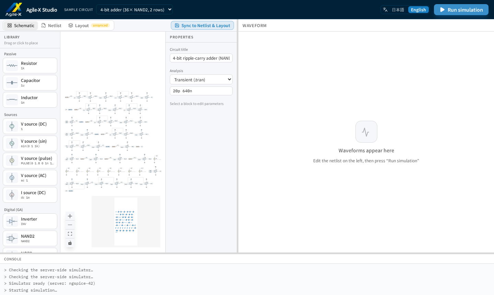
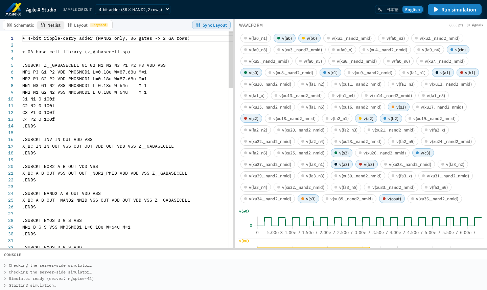
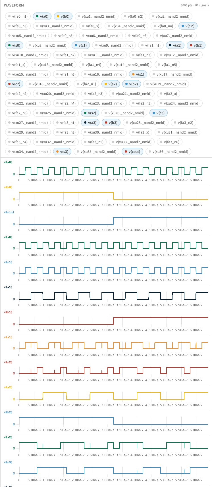
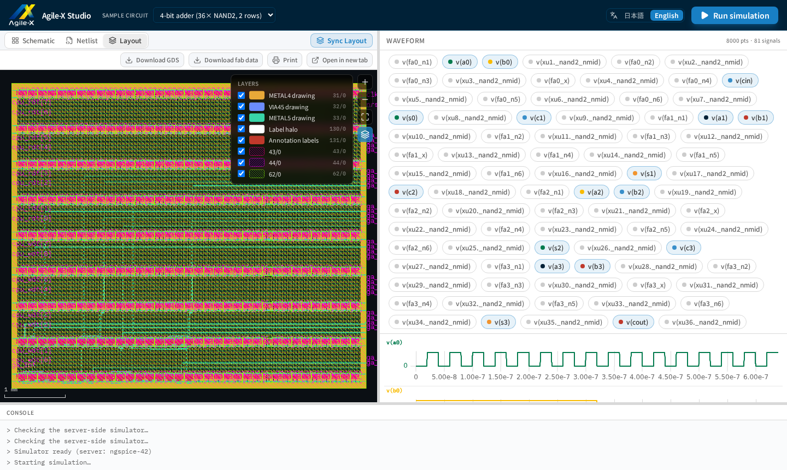

# A 4-bit adder across two rows

One row of the gate array has 35 base cells. A larger circuit is split over several rows, and the routes between rows
use the jumpers built into the base.

This tutorial uses the 4-bit adder sample (36 NAND2 gates) to check that:

- the sum is correct for all 32 input vectors;
- the 36 gates are placed in two rows and routed between them;
- the inputs and outputs are routed to the I/O pads.

## Before you start

[Your first circuit](../getting-started/first-circuit.md) introduces the controls used here.

## 1. Open the sample

In **Sample circuit**, choose **4-bit adder (36× NAND2, 2 rows)**.



The circuit is a ripple-carry adder of four full adders, each made of nine NAND2 gates:

```text
x    = a XOR b               (4 × NAND2)
s    = x XOR cin             (4 × NAND2)
cout = NOT(NAND(a,b) AND NAND(x,cin))   (1 × NAND2, reusing the NANDs above)
```

## 2. Read the netlist

Open the **Netlist** tab.



Besides the gates, the netlist has two more parts.

**Input sources**

```spice
VA0 a0 0 PULSE(0 1.8 20n 0.5n 0.5n 19.5n 40n)
...
VB0 b0 0 PULSE(1.8 0 320n 0.5n 0.5n 1u 2u)
VCIN cin 0 PULSE(0 1.8 320n 0.5n 0.5n 1u 2u)
```

The inputs change every 20 ns. A counts from 0 to 15. For the first 16 steps B = 5 and Cin = 0; for the last 16,
B = 10 and Cin = 1.

**I/O pad assignments**

```spice
* GA_IO IN 0 a0
...
* GA_IO IN 8 cin
* GA_IO OUT 0 s0
...
* GA_IO OUT 4 cout
```

A line starting with `* GA_IO` connects a net to a chip I/O pad. To SPICE it is a comment, so it does not affect the
simulation. See [Netlist](../guide/netlist.md#ga-io) for the format.

## 3. Simulate

Press **Run simulation**.

The adder's netlist has 81 signals, including the nodes inside the gates. Use the signal buttons to hide everything
except `a0`–`a3`, `b0`–`b3`, `cin`, `s0`–`s3`, `c1`–`c3` and `cout`, and it becomes easy to read.



From 0 to 20 ns, A = 0 and B = 5, so the sum is 5 (`s0` and `s2` high). From 340 to 360 ns, A = 1, B = 10 and
Cin = 1, so the sum is 12 (`s2` and `s3` high).

!!! note "The short spikes"
    Right after an input changes, `s1` or `c2` may show a short pulse. It is the intermediate value while the carry
    ripples up from the lower bits (a glitch), which is normal in a ripple-carry adder. Every step settles to the right
    value before it ends.

## 4. Build the layout

Open the **Layout** tab and press **Sync Layout**. It takes 10 to 30 seconds.



- The 36 gates are placed 18 per row in two rows. The first row runs left to right and the second right to left, so
  gates that connect across the row ends sit close together.
- Routes between the rows pass over horizontal wires using the jumpers between the rows.
- Nine input and five output wires run to the I/O pads on the right edge.

When the sync finishes, **unsynced** disappears from the Layout tab.

## 5. How the result is checked

Each layout sync verifies the routes before writing them out:

- It rebuilds the connectivity from the METAL5 shapes to be written and the pads in `base.gds`.
- If two different nets touch (a short), a net is broken (an open), or shapes of different nets are less than 5 µm
  apart, the result is discarded and placement is tried again with a different arrangement.

If the sync succeeds, the result has passed this check.

## Next

- [Layout](../guide/layout.md): how placement and routing work, and what to do when they fail
- [Gate array](../reference/gate-array.md): dimensions of the base cell, tracks, jumpers and I/O pads
