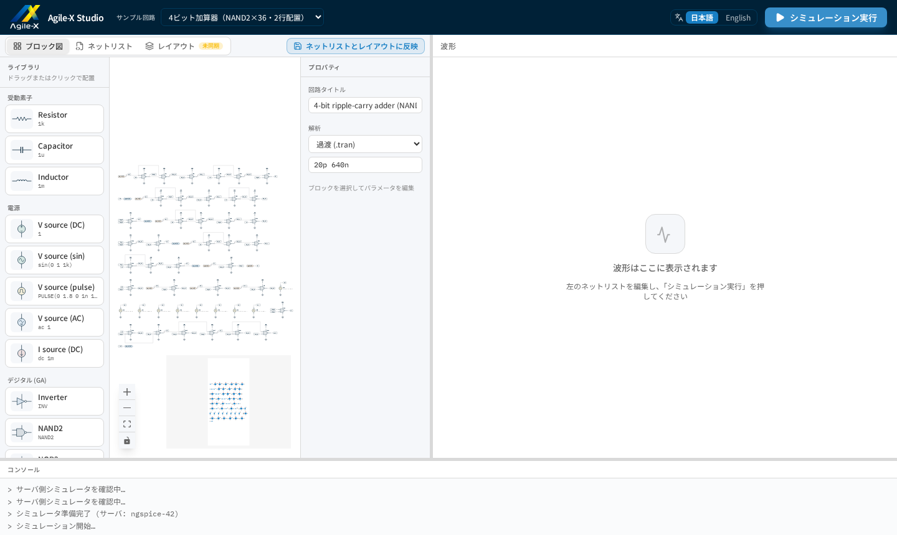
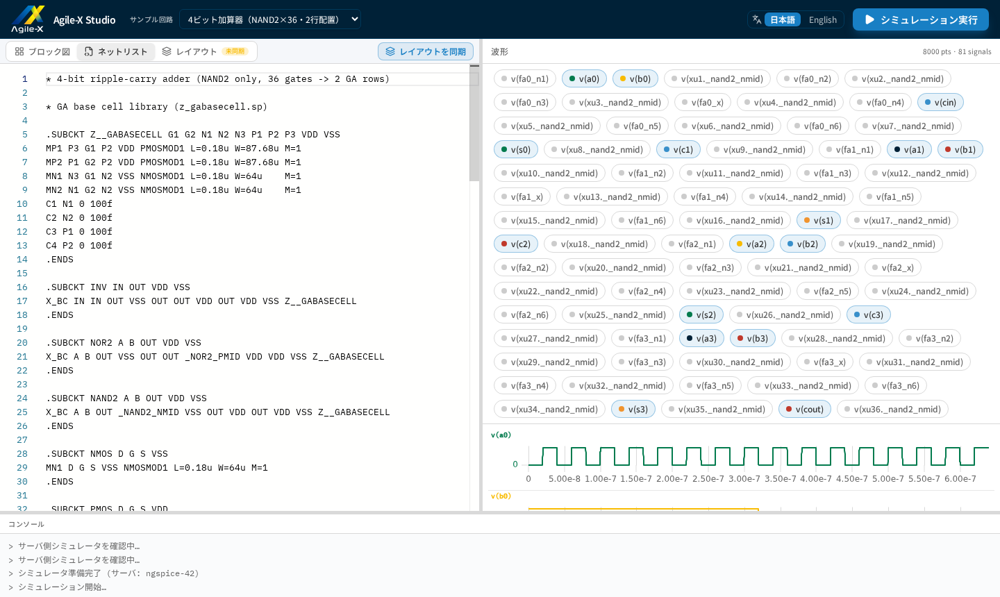
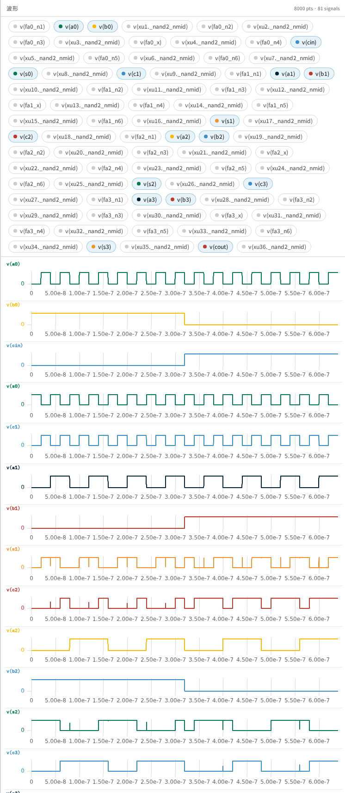
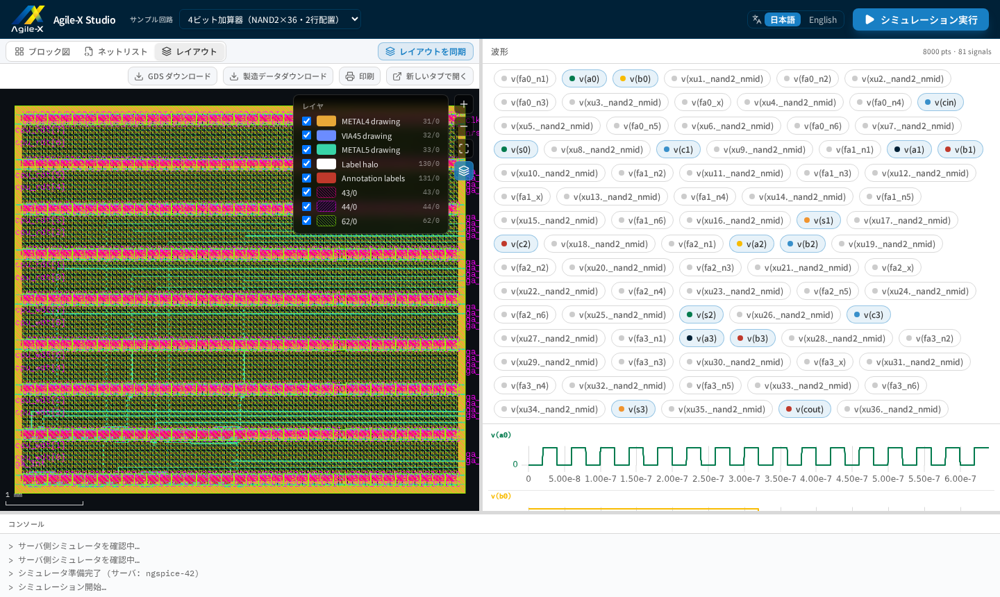

# 2 行にまたがる 4 ビット加算器

ゲートアレイの 1 行には 35 個のベースセルがあります。これより大きな回路は複数の行に分けて配置され、行と行の間はベースに組み込まれたジャンパを使って配線されます。

このチュートリアルでは、サンプルの 4 ビット加算器（NAND2 × 36）を使って次のことを確かめます。

- 32 通りの入力に対して、和が正しく出ること
- 36 ゲートが 2 行に分かれて配置され、行をまたいで配線されること
- 入出力が I/O パッドまで配線されること

## 始める前に

[最初の回路](../getting-started/first-circuit.md) を一通り済ませておくと、操作に迷いません。

## 1. サンプルを開く

**サンプル回路** で「**4ビット加算器（NAND2×36・2行配置）**」を選びます。



回路は全加算器 4 つをつないだリプルキャリー加算器です。全加算器 1 つは NAND2 9 個でできています。

```text
x    = a XOR b               (NAND2 × 4)
s    = x XOR cin             (NAND2 × 4)
cout = NOT(NAND(a,b) AND NAND(x,cin))   (NAND2 × 1、上の NAND を再利用)
```

## 2. ネットリストを読む

**ネットリスト** タブを開きます。



ネットリストには、ゲートの行のほかに次の 2 つが入っています。

**入力の電源**

```spice
VA0 a0 0 PULSE(0 1.8 20n 0.5n 0.5n 19.5n 40n)
...
VB0 b0 0 PULSE(1.8 0 320n 0.5n 0.5n 1u 2u)
VCIN cin 0 PULSE(0 1.8 320n 0.5n 0.5n 1u 2u)
```

入力は 20 ns ごとに変わります。A は 0 から 15 まで数え上げます。前半 16 ステップは B = 5・Cin = 0、後半 16 ステップは B = 10・Cin = 1 です。

**I/O パッドの割り当て**

```spice
* GA_IO IN 0 a0
...
* GA_IO IN 8 cin
* GA_IO OUT 0 s0
...
* GA_IO OUT 4 cout
```

`* GA_IO` で始まる行は、ネットをチップの I/O パッドにつなぐ指定です。SPICE ではコメントなので、シミュレーションには影響しません。書き方は [ネットリスト](../guide/netlist.md#ga-io) を参照してください。

## 3. シミュレーションする

**シミュレーション実行** を押します。

加算器のネットリストには、ゲートの内部ノードも含めて 81 本の信号があります。信号名のボタンを押して、`a0`〜`a3`・`b0`〜`b3`・`cin`・`s0`〜`s3`・`c1`〜`c3`・`cout` 以外を非表示にすると読みやすくなります。



たとえば 0〜20 ns では A = 0、B = 5 なので、和は 5（`s0` と `s2` が High）です。340〜360 ns では A = 1、B = 10、Cin = 1 なので、和は 12（`s2` と `s3` が High）です。

!!! note "細いひげについて"
    入力が変わった直後に、`s1` や `c2` に短いパルスが出ることがあります。キャリーが下位ビットから順に伝わる間の一時的な値（グリッチ）で、リプルキャリー加算器では普通に起きます。各ステップの終わりには正しい値に落ち着きます。

## 4. レイアウトを作る

**レイアウト** タブを開き、**レイアウトを同期** を押します。10〜30 秒ほどで終わります。



- 36 ゲートが 2 行に 18 個ずつ配置されます。1 行目は左から右へ、2 行目は右から左へ並ぶので、隣の行とつながるゲートが近くに来ます。
- 行をまたぐ配線は、行の間にあるジャンパで横方向の配線を飛び越えています。
- 右端の I/O パッドまで、入力 9 本・出力 5 本が配線されています。

同期が終わると、レイアウトタブの **未同期** の表示が消えます。

## 5. 結果を確かめる

レイアウトの同期では、配線を出力する前に検証が走ります。

- 出力する METAL5 の図形と `base.gds` のパッドから、つながっているネットを組み立て直します。
- 別のネット同士が触れている（ショート）、同じネットが途切れている（オープン）、図形の間隔が 5 µm 未満、のどれかがあれば、その結果は使わずに配置を変えてやり直します。

同期が成功した時点で、この検証は通っています。

## 次に読むもの

- [レイアウト](../guide/layout.md): 配置・配線の流れと、失敗したときの対処
- [ゲートアレイ](../reference/gate-array.md): ベースセル、配線トラック、ジャンパ、I/O パッドの寸法
